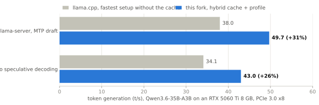
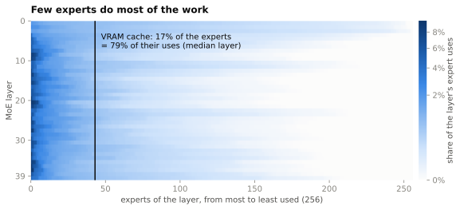
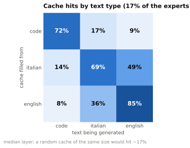

# llama.cpp with a hybrid MoE cache

A fork of [ggml-org/llama.cpp](https://github.com/ggml-org/llama.cpp) that makes MoE models faster on GPUs connected through a slow link, such as PCIe 3.0.

When the experts of a mixture-of-experts model do not fit in VRAM, llama.cpp can keep the most used ones in a GPU cache (`--moe-cache-mib`), but every expert missing from the cache is uploaded before the layer runs. On a slow link the uploads cost more than they save, and the cache ends up slower than no cache at all. The **hybrid mode** computes the cached experts on the GPU and the missing ones on the CPU, at the same time, with nothing uploaded on the critical path.

## Results

Qwen3.6-35B-A3B on an RTX 5060 Ti 8 GB (PCIe 3.0 x8) with an i7-10700K and DDR4-2666:

<picture>
  <source media="(prefers-color-scheme: dark)" srcset="../docs/images/moe-cache-hybrid-speed-dark.svg">
  
</picture>

For comparison, the upstream MoE cache gives 25.6 t/s on the same machine without speculative decoding. Same output: perplexity within the error, and the scheduler change gives the same text bit for bit. Prompt processing is 16% slower, since all the experts stay in RAM.

## How it works

A small cache is enough because the router is far from uniform: in each layer a few experts get most of the tokens. With 17% of the experts in VRAM, the GPU serves 79% of the expert uses of the median layer, and the CPU computes the rest.

<picture>
  <source media="(prefers-color-scheme: dark)" srcset="../docs/images/moe-cache-hybrid-experts-dark.svg">
  
</picture>

- **Hits on the GPU, misses on the CPU**: each expert of a token runs on one device only, the two partial results are added.
- **CPU and GPU in parallel**: the scheduler copies the inputs of the CPU split before it launches the GPU split.
- **Frequency-based cache**: decayed use counts decide which experts stay in VRAM, within an upload budget per token.
- **Warm start**: a profile file saves the scores at exit and fills the cache at the next start.

## Different text, different experts

Which experts are hot depends on what the model writes. A cache filled while writing Python code serves an English story only 9% of the time, less than a random cache would; the same story in Italian and in English shares about 40% of the hot experts. So the profile should match the use (one for code, one for chat), and a wrong profile is a cold start that the frequency policy corrects in a few hundred tokens.

<picture>
  <source media="(prefers-color-scheme: dark)" srcset="../docs/images/moe-cache-hybrid-topics-dark.svg">
  
</picture>

One 512-token sample per text type, so take it as a first look rather than a study.

## Quick start

```bash
llama-server -m Qwen3.6-35B-A3B-UD-Q4_K_M.gguf -ngl 99 -fa on --n-cpu-moe 40 \
  --moe-cache-mib 3200 --moe-cache-hybrid --moe-cache-profile qwen36.moeprof
```

Build as usual (see the [build guide](../docs/build.md)), with `-DGGML_CUDA=ON`.

## More

- [Design, test system, full results and limitations](../docs/moe-cache-hybrid.md)
- [GPU check](../scripts/moe-cache-hybrid-check.ps1) to run before merging an update from upstream
- The branch follows upstream through a weekly merge PR ([workflow](workflows/moe-cache-hybrid-sync.yml))
- [Original llama.cpp README](../README.md)

Same MIT license as llama.cpp. All the credit for llama.cpp goes to its authors; this fork only adds the hybrid cache.
